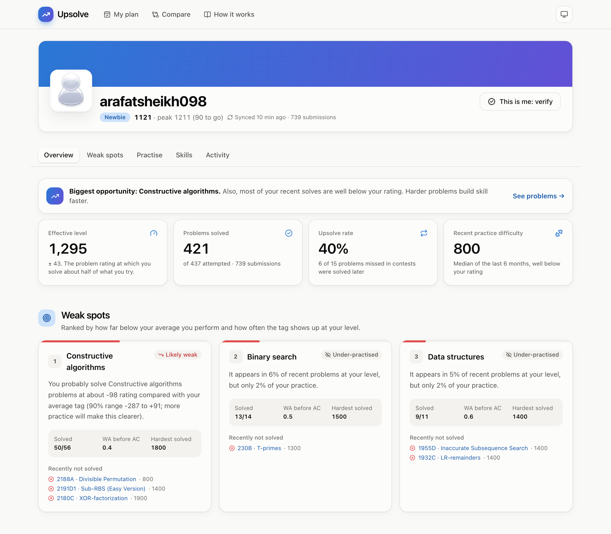
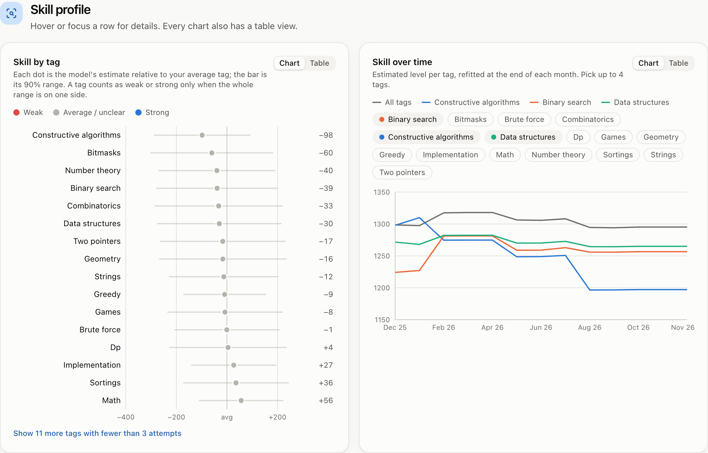
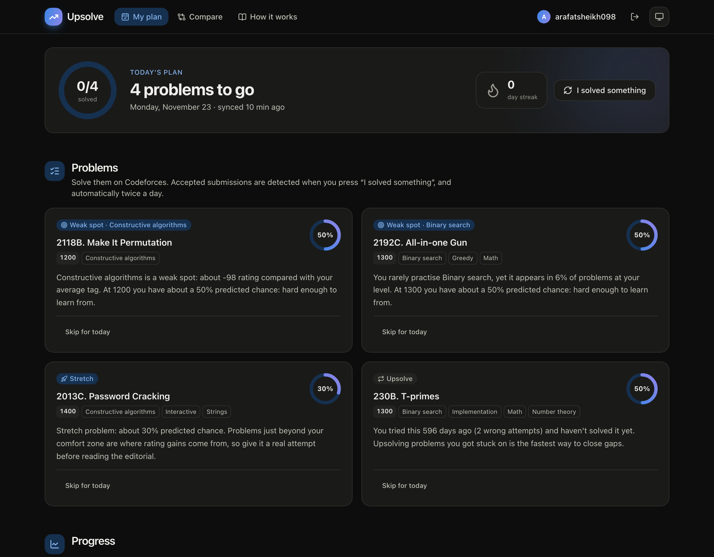

# Upsolve: a Codeforces weakness coach

[](https://github.com/arafatsheikh098/upsolve/actions/workflows/ci.yml)


Upsolve reads a Codeforces handle's full submission history and does three things:

- it **estimates skill per tag** with a statistical model, with honest 90% confidence ranges
- it **finds the real weak spots**: tags where you underperform, or that are common at your level
  but missing from your practice
- it builds a **daily practice plan** of unsolved problems at the right difficulty

It doesn't use AI. The model and recommender are written from scratch (numpy), explainable line by
line, and tested against simulated users with known skills.



## Features

- **Per-tag skill model.** A logistic regression on the Codeforces rating scale, fitted by MAP
  (Newton's method), with Laplace-approximation intervals.
  [Read the maths →](docs/MODEL.md)
- **Weak spots with evidence.** Each one shows its solve rate, wrong answers before AC, hardest
  solve and recent failures, so it's clear *why* a tag is flagged.
- **Recommendations at the right difficulty.**
  - Weak-tag problems at about a 55% predicted chance of solving.
  - One stretch problem at about 30%.
  - One failed problem brought back with spaced repetition (1, 3, 7, 21 days).
  - Picks are deterministic per day.
- **Skill over time.** The model is refitted at the end of each past month, so progress charts work
  for any handle on day one.
- **Handle verification without passwords.** You prove you own a handle by submitting a compilation
  error to a problem Upsolve picks. Verified users get saved daily plans, goals (focus tags, problems
  per day) and a streak.
- **Compare** two handles tag by tag.
- **Built for Codeforces' API rules.** One shared Redis rate limiter (≤ 1 call every 2 s across all
  processes), incremental sync, retries with backoff, and a background worker.
- **Accessible UI.** Light and dark themes, works at phone width, every chart has a table view, and
  the colour palette is checked for colour-blind safety.

| Skill profile | Daily plan (dark mode) |
|---|---|
|  |  |

## Tech stack

| | |
|---|---|
| Backend | Python 3.12+, FastAPI, SQLAlchemy 2 (async), Alembic, PostgreSQL, Redis, arq, numpy, httpx |
| Frontend | React 19, TypeScript, Vite, Tailwind CSS 4, TanStack Query, Recharts and hand-written SVG |
| Quality | pytest (unit, integration and model-recovery tests), ruff, mypy `--strict`, Vitest, oxlint, GitHub Actions |
| Deploy | Docker Compose: Postgres, Redis, API, worker, and nginx serving the SPA and proxying `/api` |

Architecture, data flow and design decisions are in [docs/ARCHITECTURE.md](docs/ARCHITECTURE.md).

## Quick start

```bash
cp .env.example .env          # change JWT_SECRET
docker compose up --build
```

Open http://localhost:8080 and enter a handle. The API docs are at http://localhost:8080/api/docs.

On first start the worker loads the problemset (about 11,500 problems, a few seconds). A handle's
first sync takes a few seconds; large accounts with over 10,000 submissions take up to a minute,
because of Codeforces' rate limit.

## Development

```bash
docker compose up -d db redis

# backend
cd backend
python -m venv .venv && .venv/bin/pip install -e ".[dev]"
.venv/bin/alembic upgrade head
.venv/bin/uvicorn app.main:app --reload      # API on :8000
.venv/bin/arq app.worker.WorkerSettings      # worker (second terminal)

# frontend
cd frontend
npm install
npm run dev                                  # http://localhost:5173, proxies /api to :8000
```

### Checks

```bash
cd backend  && ruff check . && ruff format --check . && mypy app && alembic check && pytest
cd frontend && npm run lint && npm run typecheck && npm test && npm run build
```

The backend integration tests use a real Postgres (`upsolve_test` database, created automatically)
and Redis db 15, and are skipped if those aren't running.

## Project layout

```
backend/app/
  analysis/    features.py · skill.py (the model) · report.py (weak spots) · recommend.py
  cf/          client.py (typed CF API client) · ratelimit.py · sync.py
  api/         handles.py · auth.py (verification) · plans.py (plans, goals, progress)
  worker.py    arq jobs and cron
frontend/src/
  pages/       Home · Profile · Plan · Compare · How it works
  charts/      Forest (SVG forest plot) · Recharts line and bar charts
docs/          MODEL.md · ARCHITECTURE.md
```

## Disclaimer

Upsolve is an independent project. It isn't affiliated with Codeforces and only reads public data
through the official [Codeforces API](https://codeforces.com/apiHelp).

## License

[MIT](LICENSE)
