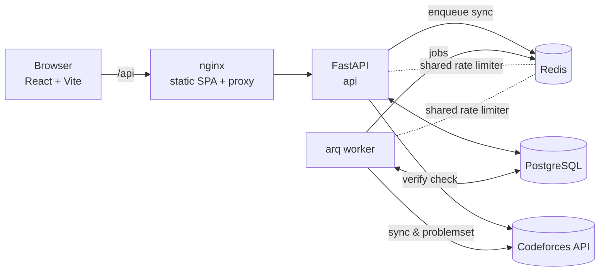

# Architecture

## Request flow: analyzing a handle

1. The browser calls `POST /api/handles/{h}/sync`. The API returns immediately with the sync state:
   - `ready` and synced in the last 10 minutes: nothing to do
   - already `queued` or `syncing`: nothing to do
   - otherwise: enqueues `sync_handle_job` in Redis, with a job id per handle so jobs don't duplicate
2. The worker fetches `user.info`, then `user.status` pages from newest to oldest until it reaches a
   submission it already has (incremental sync), then `user.rating`. Everything is upserted.
3. The browser polls `GET /api/handles/{h}/status` every 1.5 s until the state is `ready`.
4. `GET /api/handles/{h}/analysis` loads submissions, rating history and the cached problemset, then
   runs the model (`app/analysis`). The JSON result is cached in Redis, keyed by the last
   submission id and sync time, so it is invalidated by every sync.

## Codeforces rate limit

Codeforces asks clients to make at most one call every 2 seconds. Every call, from any process,
goes through `RedisRateLimiter`. A Lua script atomically reserves the next free slot using Redis's
own clock; the caller then sleeps until that slot. API and worker processes share one schedule,
which a test checks. Transient failures (network errors, 5xx, 429, "Call limit exceeded") are
retried with exponential backoff.

## Data model

| table | purpose |
|---|---|
| `problems` | the problemset: tags, rating, solved count, contest start (refreshed nightly) |
| `handles` | profile and sync state per handle (`key` = lower-cased handle) |
| `submissions` | submissions, with a snapshot of the problem's rating and tags |
| `rating_changes` | rating history |
| `users`, `verifications` | verified handle owners and pending verification challenges |
| `goals`, `plans`, `plan_items` | daily plans and their status |

## Verification

Codeforces has no "log in with Codeforces" for third-party apps. Upsolve picks a random 800-rated
problem and asks the user to submit a **compilation error** to it within 5 minutes. On check, the
API reads the user's 10 most recent submissions. If a CE on that problem appears after the
challenge started, it creates the user and sets an httpOnly, SameSite=Lax JWT cookie. Starting and
checking are rate-limited per IP and per handle, and each challenge can be used once.

## Background jobs

| job | when |
|---|---|
| `sync_handle_job` | on demand |
| `refresh_problemset_job` | worker start-up if empty, then daily at 03:00 UTC |
| `sync_verified_users` | 00:30 and 12:30 UTC, so plans update without pressing refresh |
| `cleanup` | hourly: expired verifications, handles that never synced |

## Why these choices

- **Python + numpy for the model.** The model is about 150 lines of linear algebra, so there's no
  ML framework to deploy.
- **Plans and history are recomputed, not stored.** Fits are deterministic and take milliseconds,
  so "skill over time" works for any handle on its first visit.
- **A separate worker.** A first sync for a big account takes 20–50 s. That must never block an
  API request.
